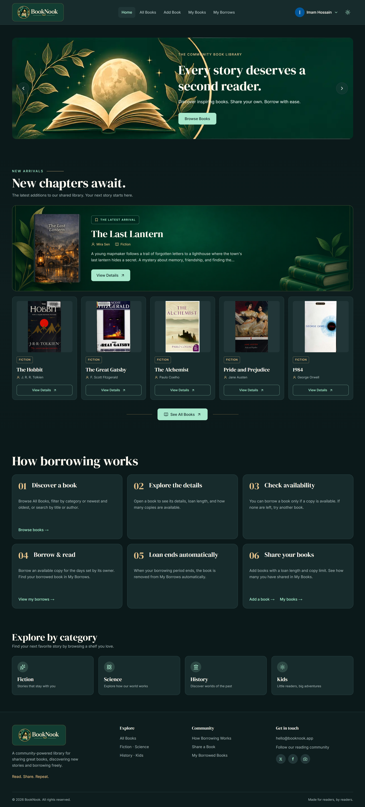

# 📚 BookNook — Community Book Sharing & Borrowing Platform

**Every story deserves a second reader.**

BookNook is a full-stack community library platform where readers can **discover, share, borrow, and return books**. Members can contribute books from their own shelves, explore titles shared by others, track borrowed books and due dates, and manage their contributions through a personal dashboard.

Built with **Next.js, TypeScript, Express.js, MongoDB, and Better Auth**, BookNook features a cozy, book-inspired interface with dark/light themes and responsive layouts.

<p align="center">
  <a href="https://book-nook-client-ten.vercel.app/">🌐 <strong>Live Demo</strong></a> &nbsp;•&nbsp;
  <a href="https://github.com/imamrakib354/book-nook-client">💻 <strong>Frontend Repository</strong></a> &nbsp;•&nbsp;
  <a href="https://github.com/imamrakib354/book-nook-server">⚙️ <strong>Backend Repository</strong></a>
</p>

---

## 📸 Project Preview

<p align="center">
  
</p>

---

## ✨ Key Features

- **🔐 Authentication & Protected Routes:** Email/password registration and login, Google and GitHub sign-in, and protected pages using Better Auth with its MongoDB adapter. After signing in, users can return to the page they originally requested.
- **📖 Discover Books:** Browse the community catalog, search by title or author, filter by category, and sort by newest, oldest, or most borrowed.
- **🆕 New Arrivals:** Display the six latest books, ordered by creation date, including a featured spotlight for the newest addition.
- **➕ Share & Manage Books:** Add books, upload or link cover images, edit book information, and delete books you own.
- **📚 Borrow & Return:** Borrow available books, track loan periods and due dates, prevent repeated borrowing of the same book through the UI, and return books to restore available copies.
- **👤 Personal Dashboard:** View shared books, currently borrowed books, borrowing statistics, due-soon information, and reader profile details.
- **🖼️ ImgBB Image Uploads:** Upload book covers and profile photos through a Next.js API route, with image previews and support for pasting an image URL.
- **🌗 Dark & Light Themes:** Switch between a dark forest-green library aesthetic and a light theme using a Navbar toggle.
- **📱 Responsive UI & Feedback:** Mobile-friendly layouts, loading skeletons, spinners, confirmation dialogs, toast notifications, and custom error/404 states.

---

## 🏠 Homepage Highlights

- **Swiper.js Hero Slider:** Three promotional slides with navigation controls, autoplay, and links to browse books.
- **New Arrivals:** The latest six books from MongoDB, including a highlighted newest book.
- **How Borrowing Works:** Simple steps introducing the community borrowing process.
- **Explore by Category:** Quick links to Fiction, Science, History, Kids, and Others.

---

## 🛠️ Tech Stack

| Layer | Technologies |
| --- | --- |
| **Frontend** | Next.js (App Router), React, TypeScript |
| **Styling & UI** | Tailwind CSS, shadcn/ui, Lucide React |
| **Carousel** | Swiper.js |
| **Theme Management** | next-themes |
| **Notifications** | React Toastify |
| **Authentication** | Better Auth, MongoDB Adapter, Google OAuth, GitHub OAuth |
| **Backend** | Node.js, Express.js, REST API |
| **Database** | MongoDB |
| **API Security** | JWT verification with `jose` and Better Auth JWKS |
| **Image Hosting** | ImgBB |
| **Deployment** | Vercel (frontend and backend) |

---

## 🧭 Pages & Routes

| Route | Description | Access |
| --- | --- | --- |
| `/` | Homepage with slider, New Arrivals, borrowing guide, and categories | Public |
| `/all-books` | Search, filter, sort, and explore all books | Public |
| `/all-books/[id]` | Book details, availability, borrowing, and related books | Protected |
| `/add-book` | Add a book with a cover image | Protected |
| `/my-books` | Manage books added by the signed-in user | Protected |
| `/my-borrows` | View borrowed books, due dates, and return actions | Protected |
| `/profile` | Reader profile, statistics, and profile editing | Protected |
| `/sign-in` | Email/password and social login | Public |
| `/sign-up` | Account registration and social login | Public |

### 🔒 Authentication Flow

1. A visitor opens a protected route.
2. Next.js `proxy.ts` checks for a valid Better Auth session.
3. If unauthenticated, the visitor is redirected to `/sign-in` with the original page stored in `callbackUrl`.
4. After successful login, the visitor is redirected to the intended page.
5. Protected Express API requests use a Bearer JWT that the backend verifies using Better Auth's JWKS endpoint.

---

## 🌐 Backend API Endpoints

The Express backend exposes these routes:

| Method | Endpoint | Purpose | Access |
| --- | --- | --- | --- |
| `GET` | `/books` | Retrieve all books | Public |
| `GET` | `/books/:id` | Retrieve an individual book | Authenticated |
| `POST` | `/books` | Add a new book | Authenticated |
| `PATCH` | `/books/:id` | Update a book owned by the user | Owner only |
| `DELETE` | `/books/:id` | Delete a book owned by the user | Owner only |
| `POST` | `/borrows` | Borrow an available book | Authenticated |
| `GET` | `/borrows` | Retrieve the current user's borrowed books | Authenticated |
| `DELETE` | `/borrows/:id` | Return a borrowed book | Borrower only |
| `GET` | `/new-arrivals` | Retrieve the six newest books | Public |

**Additional Next.js API routes:**

- `POST /api/books` — Validates the Add Book request and forwards it to Express with the user's JWT.
- `POST /api/upload-image` — Validates the selected image and uploads it to ImgBB using a server-side API key.
- `/api/auth/[...all]` — Better Auth endpoints for sessions and authentication.

### 📦 MongoDB Collections

- **`BooksCollection`** — Book details, cover URL, available copies, borrowing period, ownership, borrow count, and creation date.
- **`BorrowedBooks`** — Borrowed-book records with the associated book, borrower, borrow date, and due date.
- **Better Auth data** — User accounts, sessions, and authentication-related records managed through the MongoDB adapter.

When a book is borrowed, its available copy count decreases. When it is returned, the available copy count increases.

---

## 📁 Frontend Project Structure

```text
public/
└── images/                 # Logo, slider images, preview, and page assets

src/
├── app/
│   ├── api/
│   │   ├── auth/[...all]/   # Better Auth route handler
│   │   ├── books/           # Add Book API handler
│   │   └── upload-image/    # ImgBB upload handler
│   ├── add-book/
│   ├── all-books/
│   │   └── [id]/
│   ├── my-books/
│   ├── my-borrows/
│   ├── profile/
│   ├── sign-in/
│   ├── sign-up/
│   ├── globals.css
│   ├── layout.tsx
│   └── page.tsx
├── components/
│   ├── Home_Page/          # Banner, New Arrivals, categories, borrowing guide
│   ├── My-Page/            # Edit, delete, and manage shared books
│   ├── My-Borrows-Page/    # Borrowing and returning interfaces
│   ├── profilePage/        # Profile management components
│   ├── ui/                 # shadcn/ui components
│   ├── add-book-form.tsx
│   ├── allBooks.tsx
│   ├── bookCard.tsx
│   ├── navbar.tsx
│   ├── footer.tsx
│   └── theme-provider.tsx
├── lib/
│   ├── auth.ts             # Better Auth server configuration
│   ├── auth-client.ts      # Better Auth React client
│   ├── getTokenFromClient.ts
│   ├── getTokenFromServer.ts
│   ├── upload-image.ts
│   └── types/              # Book and borrow TypeScript interfaces
└── proxy.ts                # Protected-route checks and login redirects
```

The Express backend is maintained in its [separate repository](https://github.com/imamrakib354/book-nook-server).

---

## 🚀 Getting Started

### 1. Clone the repositories

```bash
git clone https://github.com/imamrakib354/book-nook-client.git
git clone https://github.com/imamrakib354/book-nook-server.git
```

### 2. Install frontend dependencies

```bash
cd book-nook-client
npm install
```

### 3. Configure frontend environment variables

Create `.env.local` in the frontend project:

```env
BETTER_AUTH_URL=http://localhost:3000
BETTER_AUTH_SECRET=your_better_auth_secret
MONGODB_URI=your_mongodb_connection_string

BETTER_AUTH_GOOGLE_CLIENT_ID=your_google_client_id
BETTER_AUTH_GOOGLE_CLIENT_SECRET=your_google_client_secret
BETTER_AUTH_GITHUB_CLIENT_ID=your_github_client_id
BETTER_AUTH_GITHUB_CLIENT_SECRET=your_github_client_secret

IMGBB_API_KEY=your_imgbb_api_key
NEXT_PUBLIC_API_URL=http://localhost:8000
```

### 4. Configure the backend

In the separate Express backend project, install its dependencies and create a `.env` file:

```bash
cd ../book-nook-server
npm install
```

```env
MONGODB_URI=your_mongodb_connection_string
CLIENT_URL=http://localhost:3000
PORT=8000
```

Ensure that the backend and frontend point to the same MongoDB database and that your OAuth providers have the appropriate localhost callback URLs configured.

### 5. Run the applications

Start the Express server using the run command configured in its repository. For example, if its entry file is `index.js`:

```bash
node index.js
```

Then start the Next.js frontend in a separate terminal:

```bash
cd book-nook-client
npm run dev
```

Open **http://localhost:3000**.

> **Deployment note:** Use the deployed frontend URL for `BETTER_AUTH_URL` and backend `CLIENT_URL`, and the deployed backend URL for `NEXT_PUBLIC_API_URL`. Avoid trailing slashes when the application appends paths such as `/books` and `/api/auth/jwks`. Keep `IMGBB_API_KEY` server-side; do not prefix it with `NEXT_PUBLIC_`.

---

## 🧠 What I Learned & Practiced

- Building a full-stack application with **Next.js App Router** and a separate **Express REST API**.
- Working with **MongoDB CRUD operations**, sorting, limiting, and updating book availability.
- Implementing **Better Auth**, Google/GitHub OAuth, protected routes, and return-to-page redirects.
- Sending and verifying **JWT Bearer tokens** between frontend and backend.
- Creating image-upload flows with **FormData**, a server-side API route, and **ImgBB**.
- Managing interactive React forms, dialogs, loading states, and toast notifications.
- Creating responsive interfaces with **Tailwind CSS**, **shadcn/ui**, and dark/light themes.
- Deploying and connecting separate frontend and backend projects on **Vercel**.

---

## 💡 Future Improvements

- Borrowing history for books that have already been returned.
- Email notifications before due dates.
- Password reset and optional email verification.
- Pagination for larger book collections.
- Community reviews and book ratings.

---

## 👨‍💻 Author

**Imam Hossain Rakib**  
GitHub: [@imamrakib354](https://github.com/imamrakib354)

---

<p align="center">
  Built with ❤️ for readers who believe every book deserves another journey.
</p>
